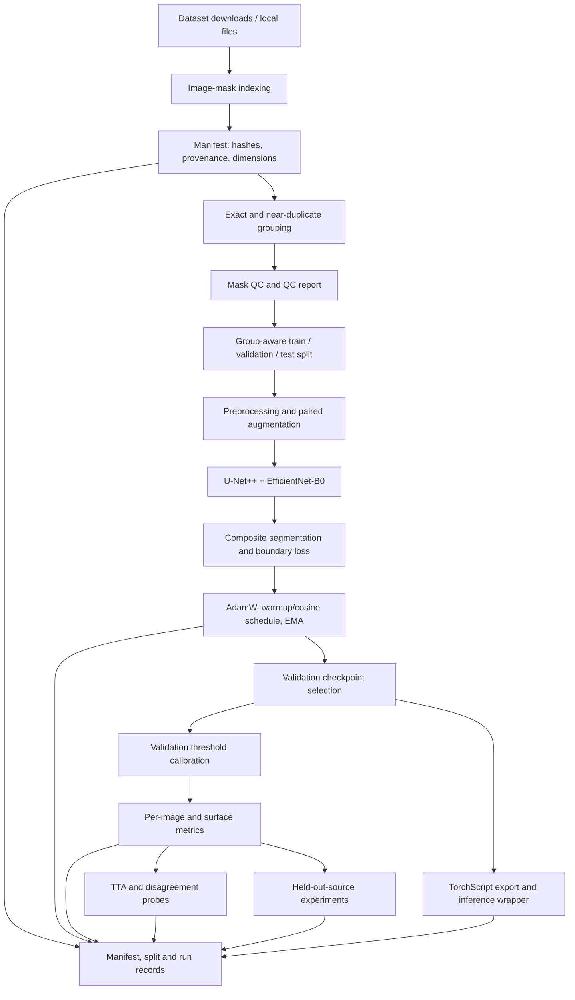

# LungSeg 

**Multi-source lung-field segmentation in chest radiographs, with provenance-aware evaluation and reproducible experiment controls.**

LungSeg is a research pipeline for binary lung-field segmentation in grayscale chest X-rays. The reference implementation is provided as a Jupyter notebook (`LungSeg.ipynb`). It combines a U-Net++-style encoder–decoder with an EfficientNet-B0 encoder, optional deep-supervision heads, a contour-oriented auxiliary head, and a composite pixel-wise/overlap objective. The surrounding pipeline covers data indexing, annotation provenance, duplicate-aware splits, mask quality checks, resumable training, validation-based model selection, geometric evaluation, test-time augmentation (TTA), an exploratory uncertainty analysis, source-held-out experiments, and TorchScript export.

The project is designed to make segmentation experiments easier to audit. It is not a clinical device, and the notebook's implemented checks or smoke runs should not be read as evidence of clinical safety or external validity.

## Research questions

The pipeline is structured to investigate four related questions:

1. **Segmentation quality:** does the selected architecture recover the lung fields accurately, including their boundaries, across heterogeneous chest-radiograph collections?
2. **Loss design:** do auxiliary decoder supervision and a contour-aware boundary objective improve results beyond the main segmentation objective?
3. **Domain transfer:** how much performance changes when an entire source collection, source group, or supervision tier is withheld from training?
4. **Review support:** does disagreement between TTA predictions help identify cases with lower segmentation quality, and is any gain large enough to justify its inference cost?

These questions require the planned ablations and source-held-out runs to be completed with controlled seeds and an independent final evaluation. The notebook contains the mechanisms for much of this work, but it does **not** contain a complete, full-budget execution of every proposed experiment.

## Pipeline at a glance



## 1. Data sources and annotation provenance

Data are acquired through `kagglehub`. The notebook maps four dataset references to eight logical source labels:

| Logical source | Dataset reference in the notebook | Supervision tier | Domain group |
|---|---|---|---|
| `montgomery` | `heyoujue/lungsegmentation` | `curated` | `montgomery` |
| `shenzhen` | `heyoujue/lungsegmentation` | `curated` | `shenzhen` |
| `jsrt` | `abduzzami/jsrt-247-image-lung-segmentation-mask-dataset` | `curated` | `jsrt` |
| `covid` | `tawsifurrahman/covid19-radiography-database` — `COVID` subset | `clinical` | `covid_db` |
| `covid_opacity` | Same COVID-19 database — `Lung_Opacity` subset | `clinical` | `covid_db` |
| `covid_normal` | Same COVID-19 database — `Normal` subset | `clinical` | `covid_db` |
| `covid_vp` | Same COVID-19 database — `Viral Pneumonia` subset | `clinical` | `covid_db` |
| `darwin` | `sawravturjo/chest-x-ray-with-masks-montgomery-shenzhen-darwin` | `weak` | `darwin_repackaged` |

The source labels are not equivalent to eight independent acquisition domains. In particular, the four COVID subsets belong to one broader database campaign and must be held out together when the research question concerns generalization to that campaign. The Darwin package uses automatically generated masks and may contain repackaged material from other collections. Provenance therefore remains relevant even after image-level duplicate checks.

The `tier` field is retained throughout the pipeline because evaluation against a weak or pseudo-annotated mask measures agreement with that annotation, not necessarily agreement with anatomical truth. The available data do not provide a consistent cross-dataset patient identifier, so the pipeline cannot guarantee patient-level separation.

## 2. Manifest, identity checks, and leakage control

`build_manifest()` creates one row per indexed image–mask pair and records, among other fields:

- case identifier, image path, mask path, source, domain group, and supervision tier;
- image and mask dimensions;
- SHA-256 hashes for image and mask files;
- a 64-bit difference hash (`dhash_img`) for approximate visual identity;
- `dup_group`, which joins detected duplicate relationships;
- `mask_conflict`, which flags identical image bytes paired with differing mask bytes;
- QC results and the eventual split assignment.

SHA-256 identifies byte-identical files. The perceptual hash is used as an approximate check for images that may have been resized or recompressed. Candidate pairs are compared using Hamming distance; relationships are joined with a union-find structure. The default perceptual-hash threshold is four bits. Split assignment operates on duplicate groups, reducing the risk that a detected copy appears in both training and evaluation.

These checks are safeguards, not proof of patient independence. Perceptual hashing may miss cropped, rotated, intensity-transformed, or otherwise modified copies, and identical patients can be represented by different acquisitions. The manifest should be retained with all result tables because it is the audit trail needed to explain source-level differences and review suspected overlaps.

## 3. Mask quality control

The rule-based QC stage records mask readability, foreground area fraction, connected-component count, approximate left–right symmetry, border contact, and flags for non-binary content or dimension mismatch. The current area and geometry rules use the following settings:

| Rule | Current behavior |
|---|---|
| Foreground fraction | `WARN` below 0.05 or above 0.65; hard area failure below 0.02 or above 0.85 |
| Connected components | `WARN` above 4; hard failure at 12 or more |
| Approximate symmetry IoU | Adds a soft violation below 0.35 when foreground exists |
| Final level | `FAIL` for a hard violation or at least two soft violations; otherwise `WARN` for one soft violation, else `PASS` |
| Border contact | Recorded as a diagnostic; it does not independently change the level in the current implementation |

QC is intentionally not a substitute for reviewing the anatomy. A plausible area or symmetric mask can still be incorrect, and genuine images can violate simple geometric rules. `QC-FAIL` cases are removed from the training split when `qc_drop_from_train=True`, but evaluation rows are retained with their flags. Headline metrics should therefore include all evaluation rows, with a second QC-filtered view reported only as a sensitivity analysis.

**Implementation note:** the present `_qc_row()` call supplies the mask's own dimensions as the comparison dimensions. As a result, the current `shape_mismatch` flag does not genuinely compare the original image dimensions with the mask dimensions. The QC path should be corrected to read the image shape and compare it with the mask shape before this field is relied upon.

The false-rejection rate of the QC gate has not been calibrated against an independently reviewed sample. Its thresholds should be treated as heuristic rules until that manual audit is carried out.

## 4. Split protocol

### Internal split

The default split targets approximately **70% training / 15% validation / 15% test**, assigned by duplicate group and stratified operationally within source. The per-source validation and test minima help small collections contribute to evaluation; group-level assignment can make the realized percentages differ from the targets. A stable seed and stable source-derived ordering are used to make the split repeatable.

The resulting manifest is saved as `manifest.csv`, and test identities are frozen in `test_frozen.csv`. The existence of a frozen split does not alone make it an untouched confirmatory test: TTA and post-processing choices are subsequently compared using the nominal test subset in this notebook. Those comparisons are exploratory and can influence selection bias.

### Held-out-source protocol

The `holdout` option supports an individual source (for example, `jsrt`), a supervision tier (for example, `tier:weak`), or a domain group (for example, `group:covid_db`). All detected duplicate groups associated with the held-out rows move together. The held-out data are excluded from training, while the remaining data are used to build the development split.

The notebook demonstrates this mechanism with a reduced-budget JSRT holdout. That run is an execution-path check, not a definitive estimate of domain generalization. The complete matrix over sources, `group:covid_db`, `tier:weak`, and multiple random seeds remains to be run at the intended budget.

## 5. Preprocessing and data augmentation

Images are read as grayscale arrays and masks are converted to binary foreground/background labels. The data module applies a common spatial transform to each image and its corresponding mask, using nearest-neighbour interpolation for masks to avoid creating fractional labels.

### Resize and normalization choices

- `img_size=224` is the baseline model-space resolution.
- `resize_mode=stretch` resizes directly to a square canvas. It is simple but may distort aspect ratio.
- `resize_mode=pad` scales the image to fit and pads the canvas, preserving aspect ratio. Padding geometry is used when mapping a prediction back to the original image.
- `norm_mode=zero_one` is the baseline and scales image intensities into `[0, 1]`.
- `norm_mode=imagenet_gray` uses the configured single-channel mean and standard deviation (`0.449`, `0.226`).
- `norm_mode=train_stats` intends to estimate normalization statistics from the training split only, then applies those statistics to validation/test images.

The normalization and resize alternatives are exposed as experiment variants. The `train_stats` estimator currently has a variance-calculation issue: it averages per-image variances and then subtracts the square of the global mean without adding the per-image means squared. This can produce an unrealistically small standard deviation. Fix and validate this calculation before using `norm_train_stats` for comparative claims.

### Training augmentation

The training transform includes:

- horizontal reflection, probability 0.5;
- affine scale in `[0.9, 1.1]`, rotation in `[-10°, 10°]`, and translation up to 5%;
- random brightness/contrast adjustment, probability 0.4;
- CLAHE, probability 0.2.

Image and mask undergo the same geometry; mask interpolation remains nearest-neighbour. A sample's transform seed is derived from the run seed, epoch, and case identifier. This makes augmentation repeatable for a given sample and epoch even if data-loader ordering changes. The notebook includes checks for mask binarization, flip alignment, affine mask interpolation, and repeated-transform determinism.

One COVID subset contains images at 299×299 with masks at 256×256. The pipeline aligns both to the configured model grid because they refer to the same nominal field of view. This source-specific property is documented rather than assuming raw array dimensions always match.

## 6. Network architecture

The baseline `LungSegNet` combines three related components:

1. **Encoder:** EfficientNet-B0 initialized with ImageNet weights when those weights can be loaded.
2. **Segmentation path:** a U-Net++ nested decoder and binary segmentation head supplied through `segmentation_models_pytorch`.
3. **Auxiliary heads:** three 1×1 convolutional segmentation heads attached to intermediate encoder feature levels, plus a separate contour head operating on the decoder representation.

The main segmentation head produces one logit per pixel. A sigmoid converts logits to foreground probabilities for inference. The three auxiliary predictions are resized to the input resolution and supervise intermediate representations during training. The boundary head predicts a morphology-derived contour band; its role is to provide a local boundary signal during optimization, not to act as an independently trained segmentation model.

The nested decoder follows the motivation of U-Net++: dense skip pathways reduce the semantic mismatch between shallow spatial features and deeper semantic representations. EfficientNet-B0 provides the default pretrained feature extractor, balancing representational capacity and computational cost. See the original [U-Net++ paper](https://arxiv.org/abs/1807.10165) and [EfficientNet paper](https://proceedings.mlr.press/v97/tan19a.html) for the underlying architectural ideas.

The implementation can select other supported architectures (`unet`, `manet`, `fpn`, `deeplabv3plus`) and encoders through configuration. It probes the installed segmentation-library decoder calling convention to handle differences between library versions. If pretrained initialization fails, the notebook records the failure and falls back to random initialization. Such a run must not be reported as ImageNet-initialized.

## 7. Objective function

Let `Lseg(z, y)` denote the sum of Tversky loss and focal loss for logits `z` and binary target `y`. With main output `z₀`, auxiliary outputs `zᵢ`, auxiliary weights `wᵢ`, and boundary term `Lb`, the configured objective is:

\[
L = \frac{L_{seg}(z_0,y)+\sum_i w_i L_{seg}(z_i,y)}{1+\sum_i w_i} + \lambda_b L_b
\]

The auxiliary term is included only when deep supervision is enabled; the boundary term is included only when the boundary objective is enabled.

### Tversky loss

The Tversky index used by the notebook is

\[
TI=\frac{TP+\epsilon}{TP+\alpha FP+\beta FN+\epsilon},\qquad L_T=1-TI,
\]

with `α=0.7`, `β=0.3`, and smoothing `ε=1`. In this implementation, false positives receive the coefficient `α`, and false negatives receive `β`; these coefficients should be reported exactly as implemented because conventions differ across codebases. The asymmetry changes the precision/recall trade-off and should be treated as an experiment parameter rather than an established optimum. Background and foreground imbalance motivate overlap-oriented objectives such as Tversky; see [Salehi et al. (2017)](https://arxiv.org/abs/1706.05721).

### Focal loss

The focal term applies a modulation factor to binary cross-entropy so that well-classified pixels contribute less than hard pixels. The configured values are `γ=2` and `α=0.25`. Its purpose here is to reduce the dominance of easy background pixels in a dense binary-prediction task. The original motivation is described by [Lin et al. (ICCV 2017)](https://openaccess.thecvf.com/content_iccv_2017/html/Lin_Focal_Loss_for_ICCV_2017_paper.html).

### Boundary term

The boundary target is generated using dilation and erosion of the ground-truth mask to form a morphological band with `band_px=8` on the resized model grid. Binary cross-entropy is weighted more heavily on the band (`pos_weight=2.0`) while retaining a background floor (`bg_floor=0.05`). This is a contour-sensitive surrogate defined in model-space pixels; it is not a direct Hausdorff-distance or surface-distance loss. Its effective width in original-image coordinates changes with the resizing policy and image size.

The A0–A3 presets are intended to isolate the effect of auxiliary supervision and the boundary term:

| Preset | Auxiliary heads | Boundary term |
|---|---:|---:|
| `A0_no_aux_no_boundary` | Off | Off |
| `A1_aux_only` | On | Off |
| `A2_boundary_only` | Off | On |
| `A3_aux_and_boundary` | On | On |

Training loss alone is insufficient to establish that a change improves segmentation. Comparisons must use the same split, initialization policy, compute budget, threshold-selection rules, and evaluation procedure.

## 8. Optimization, EMA, and checkpoints

The default full-budget configuration uses AdamW with learning rate `3e-4`, weight decay `1e-4`, a warm-up period followed by cosine decay, gradient-norm clipping at `1.0`, and an EMA decay of `0.999` after a short EMA warm-up. Automatic mixed precision is enabled when appropriate for the available CUDA device and configuration. The default batch size is 32 and the full preset uses 12 epochs.

At each epoch, validation Dice is computed for both the online model and EMA weights. The higher validation score determines the checkpoint state. EMA is treated as a candidate, not assumed to be superior. `history.csv` records losses, raw/EMA validation Dice, learning rate, and epoch timing.

Three types of saved state serve different purposes:

- `run/last.pt`: resumable training state, including model and EMA parameters, optimizer and scheduler state, gradient scaler, epoch and step, random-number-generator state, configuration hash, and history;
- `run/best.pt`: validation-selected weights and metadata needed to identify whether raw or EMA weights were selected;
- `lungseg_v6_ts.pt`: exported TorchScript inference module, separate from the training checkpoint.

A resume equivalence test compares a continuous training sequence with a split sequence that saves and restores a checkpoint mid-run. Passing this test supports the tested execution path and environment; it does not guarantee bitwise reproducibility on different hardware or library versions.

**Checkpoint hygiene:** the current notebook skips training when `run/best.pt` already exists, and its loading path does not enforce a match between that checkpoint's saved configuration hash and the active configuration. Likewise, the full-state loader records but does not reject a hash mismatch. Before switching presets or changing data/splits, remove or archive incompatible run checkpoints, or update the loading logic to enforce hash equality.

## 9. Threshold selection and metric suite

The model checkpoint and the decision threshold are selected on the validation split. Threshold search tests values from `0.30` to `0.95` in increments of `0.05` and chooses the threshold with the highest mean per-image Dice. The selected threshold is recorded as `T_STAR` in `tuning_report.json` and is then used for the main test evaluation. This operating point optimizes validation Dice; it is not guaranteed to optimize boundary distance, sensitivity, calibration, or a clinical utility function.

The evaluation is image-based and includes:

- Dice and intersection over union (IoU);
- precision, recall/sensitivity, and specificity;
- empty-prediction and empty-reference rates;
- HD95 and average symmetric surface distance (ASSD);
- pixel-level Brier score and expected calibration error (ECE);
- macro per-image and pooled/sample-weighted summaries;
- source- and tier-level breakdowns;
- image-resampled bootstrap confidence intervals;
- a failure gallery containing poor, typical, and strong examples.

### Edge-case conventions

Both empty masks produce Dice/IoU of 1; if only one mask is empty, Dice/IoU are 0. Empty predictions remain visible in the failure-rate summaries. Precision is set to 1 for an empty prediction by convention and must therefore be interpreted alongside recall, Dice, and the empty-prediction rate.

The surface-distance functions extract one-pixel mask surfaces and compute directed nearest-surface distances. HD95 is the maximum of the two directed 95th percentiles; ASSD is the mean of the two directed mean distances. If both masks are empty, the distance is zero. If only one is empty, an image-diagonal penalty is returned. These distances are in pixels on the resized model grid, **not millimetres**; consistent spatial calibration is not available across all packaged sources to justify converting them to physical units.

Brier and ECE describe pixel-probability calibration under the current evaluation setup. They should not be described as clinical calibration. The implementation subsamples pixels when needed to bound computation, while confidence intervals resample images because images—not individual pixels—are the evaluation units for the reported case-level summaries.

## 10. Test-time augmentation and uncertainty probe

The TTA module evaluates identity, horizontal flip, and rotations of `+8°` and `−8°`. Each prediction is mapped back to the original coordinate frame before probabilities are averaged. Horizontal flipping has an exact inverse at the array level; rotated predictions require interpolation during the inverse affine transform, so their round trip is approximate.

The notebook compares no TTA, flip TTA, rotation TTA, and combined TTA on a subset of the nominal test set, reporting mean Dice and latency. It retains TTA only when the best non-identity option exceeds the no-TTA mean Dice by more than `0.002`. Because the same test subset is used to choose that option, the resulting decision is exploratory. TTA should be selected on development/validation data and evaluated once on a new held-out test cohort before a confirmatory claim.

The per-view standard deviation is used as a disagreement score, not as a calibrated probability of error. The notebook examines pixel-level Kendall association with segmentation error, image-level Spearman association with Dice, and a risk–coverage curve. In the current code, the uncertainty map used for this analysis is computed for at most 16 images even when the TTA evaluation subset is larger. `review_flags.csv` is therefore a small exploratory review aid, not evidence of a validated triage system.

## 11. Leave-one-source-out (LOSO) experiments

`run_loso()` trains a fresh model after excluding a designated source, domain group, or supervision tier. The held-out duplicate groups are kept out of training, and validation is formed from the remaining sources. This assesses transfer to a source or annotation regime absent from training, which is a different estimand from an internal random split.

Useful holdout targets include:

- `jsrt`, `montgomery`, or `shenzhen` for collection-level transfer;
- `group:covid_db` for transfer to the broader COVID dataset campaign;
- `tier:weak` for sensitivity to weak/automatic mask provenance.

A supervision-tier holdout must not be described as a new-site evaluation. Similarly, the four COVID subsets should not be reported as four independent external-domain replications. The current notebook runs only a reduced-budget JSRT LOSO demonstration. The full matrix with the intended training budget and at least three seeds is documented but remains unexecuted.

## 12. Inference and export

The export wrapper returns the main segmentation logits and saves a traced module as `lungseg_v6_ts.pt`. A parity test compares eager-model and traced-module logits on a random tensor and a real test image, requiring maximum absolute error below `1e-4` for those tested inputs. This verifies numerical agreement for the tested shape and environment; it does not establish parity across arbitrary input sizes, devices, precision modes, or software versions. Tracing records the executed tensor operations, so the export contract should be retested if model forward logic changes.

`predict_image(path_or_array, ...)` is the notebook's single-image research API. It reads or accepts an image, coerces it to grayscale, resizes/pads it according to the active configuration, normalizes it, runs the exported model, thresholds probabilities, optionally applies connected-component cleanup, and returns masks, probabilities, QC metadata, initialization metadata, and latency. The optional cleanup keeps the two largest connected components and fills holes. Its selection criterion is a mean Dice improvement greater than `0.001` on the tested subset.

There is an output-consistency issue to resolve before using the API downstream: when `apply_postproc=True`, `mask_model_space` is cleaned, but `mask_full_res` is reconstructed from the raw thresholded probabilities and is not passed through the same cleanup. Consumers should not assume the two returned masks represent the same post-processing policy until this is corrected. As with TTA, the current post-processing choice uses the nominal test subset and should be treated as exploratory.

## 13. Running the notebook

The implementation is a notebook rather than a packaged command-line application. Open `LungSeg_v6_rewritten_text.ipynb` and run it from top to bottom in a Python environment with PyTorch, OpenCV, NumPy, pandas, SciPy, Albumentations, `segmentation_models_pytorch`, `kagglehub`, and Matplotlib installed. Install a PyTorch build compatible with the intended CPU/CUDA runtime first. The notebook does not include a dependency lockfile, so record the actual package versions from each run.

### Data access

The real-data path downloads the dataset references listed above through `kagglehub` and requires a working network/runtime with whatever Kaggle access the environment requires. The synthetic path is intended for plumbing and self-tests; its synthetic masks are not suitable for model-performance claims.

### Run modes

`LS_RUN_MODE` controls the default compute preset. When unset or set to `auto`, the notebook selects `gpu_full` if CUDA is available and `smoke` otherwise.

| Mode | Epochs | Batch size | Model resolution | Intended use |
|---|---:|---:|---:|---|
| `smoke` | 1 | 4 | 128×128 | Code-path and self-test checks with small per-source caps |
| `fast` | 4 | 16 | 192×192 | Reduced-budget development runs |
| `gpu_full` | 12 | 32 | 224×224 | Main training budget for comparative experiments |

The name `gpu_full` does not mean every source is uncapped. The preset caps COVID subsets at 1,500 examples each for `covid`, `covid_normal`, and `covid_opacity`, 750 for `covid_vp`, and 2,000 for `darwin`; Montgomery, Shenzhen, and JSRT do not receive those explicit caps.

Examples for a Linux/macOS shell before launching Jupyter:

```bash
# Small pipeline test using synthetic data; no scientific result is implied.
LS_SYNTHETIC=1 LS_RUN_MODE=smoke jupyter lab

# Real-data smoke run.
LS_RUN_MODE=smoke jupyter lab

# Main GPU budget.
LS_RUN_MODE=gpu_full jupyter lab

# Hold out all of the COVID dataset campaign in the split protocol.
LS_RUN_MODE=fast LS_HOLDOUT=group:covid_db jupyter lab
```

For Windows PowerShell, set the variables before starting Jupyter, for example:

```powershell
$env:LS_RUN_MODE = "smoke"
$env:LS_SYNTHETIC = "1"
jupyter lab
```

The notebook also defines experiment presets such as `A0_no_aux_no_boundary`, `A1_aux_only`, `A2_boundary_only`, `A3_aux_and_boundary`, `arch_unet`, `arch_manet`, `encoder_densenet121`, `norm_train_stats`, `norm_imagenet_gray`, `resize_pad`, `train_curated_only`, and `train_no_weak`. Most variant presets inherit the `gpu_full` budget. Set one as `LS_RUN_MODE` or edit the configuration cell, then ensure that old checkpoints and outputs cannot be mistaken for the new run.

## 14. Expected artifacts

The notebook writes to `/kaggle/working` when that directory exists; otherwise it uses `ls_outputs/` relative to the notebook's working directory. The principal artifacts are:

| Artifact | Purpose |
|---|---|
| `run_config.json` | Serialized experiment configuration |
| `run_record.json` | Machine-readable record of environment, configuration, checks, and results |
| `manifest.csv` | Image/mask metadata, provenance, hashes, duplicate groups, QC and split fields |
| `qc_report.csv` | Per-case QC levels, reasons, and geometric features |
| `test_frozen.csv` | IDs assigned to test or held-out evaluation |
| `train_stats.json` | Training-derived normalization statistics when that mode is selected |
| `run/last.pt` | Resumable model/optimizer/scheduler/RNG state |
| `run/best.pt` | Validation-selected model state |
| `run/history.csv` | Training history and validation scores |
| `tuning_report.json` | Selected checkpoint metadata and validation threshold sweep result |
| `per_image_results_test.csv` | Per-case test metrics and provenance fields |
| `review_flags.csv` | Exploratory TTA disagreement and low-Dice review flags |
| `loso_jsrt_demo_result.json` | Result record for the reduced-budget JSRT LOSO demonstration |
| `lungseg_v6_ts.pt` | Exported TorchScript model |

Keep the manifest, frozen split, configuration, environment record, checkpoint, and result tables together. A weight file without its split and configuration is not sufficient to reconstruct a reported experiment.

## 15. Priority work before a definitive research report

1. Fix the training-statistics variance estimator and verify it against a direct pixel-level estimate.
2. Correct QC dimension comparison so image and mask dimensions are independently read and checked; verify how non-binary masks are flagged before binarization.
3. Enforce configuration-hash checks when resuming or loading `best.pt`; refuse to silently reuse incompatible checkpoints.
4. Make `predict_image()` return a consistent post-processing policy at model resolution and original resolution.
5. Select TTA and post-processing using validation/development data, then evaluate the frozen choices on a new untouched test cohort.
6. Calibrate the QC gate using manually reviewed masks and report its false-rejection rate.
7. Run the A0–A3 loss ablations, architecture/encoder/normalization/resize/composition variants, and full LOSO matrix with multiple seeds and comparable compute budgets.
8. Add patient-level split identifiers if they can be recovered lawfully and reliably from the source data; otherwise document the residual identity-overlap limitation.
9. Benchmark against external baselines (for example, nnU-Net or other established segmentation systems) using the same data protocol, resolution, seeds, and evaluation implementation.
10. Freeze the inference contract and thresholds before any prospective, multi-site, or reader-study assessment. Clinical use would require a separate validation and governance process.

## References

1. Z. Zhou, M. M. R. Siddiquee, N. Tajbakhsh, and J. Liang. **UNet++: A Nested U-Net Architecture for Medical Image Segmentation.** 2018. [arXiv:1807.10165](https://arxiv.org/abs/1807.10165).
2. M. Tan and Q. V. Le. **EfficientNet: Rethinking Model Scaling for Convolutional Neural Networks.** ICML, 2019. [PMLR paper](https://proceedings.mlr.press/v97/tan19a.html).
3. S. S. M. Salehi, D. Erdogmus, and A. Gholipour. **Tversky loss function for image segmentation using 3D fully convolutional deep networks.** 2017. [arXiv:1706.05721](https://arxiv.org/abs/1706.05721).
4. T.-Y. Lin, P. Goyal, R. Girshick, K. He, and P. Dollár. **Focal Loss for Dense Object Detection.** ICCV, 2017. [CVF Open Access](https://openaccess.thecvf.com/content_iccv_2017/html/Lin_Focal_Loss_for_ICCV_2017_paper.html).
5. **Segmentation Models PyTorch** — model and encoder library used by the notebook. [Documentation](https://segmentation-modelspytorch.readthedocs.io/en/latest/).
6. **PyTorch JIT/TorchScript tracing** — export mechanism used by the notebook. [PyTorch JIT technical overview](https://github.com/pytorch/pytorch/blob/main/torch/csrc/jit/OVERVIEW.md).

---
